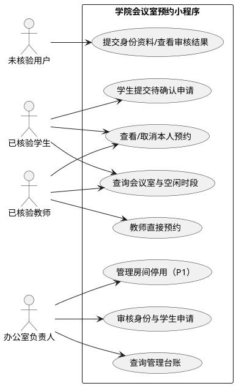
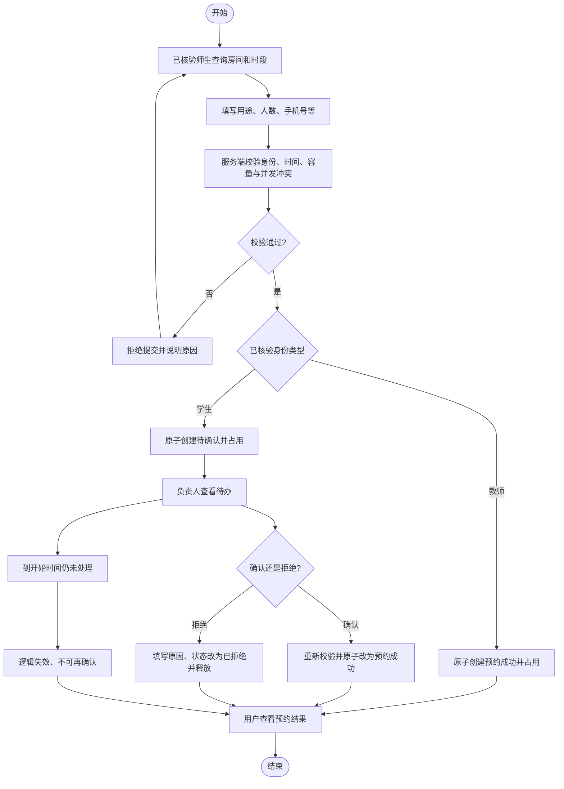
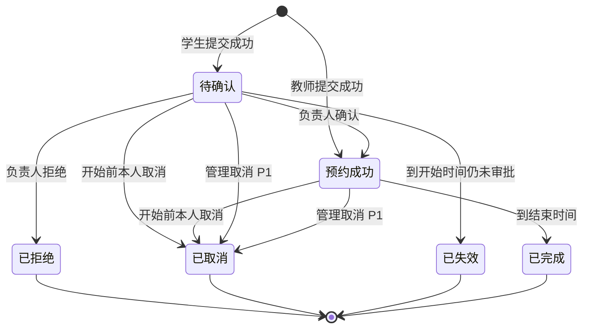
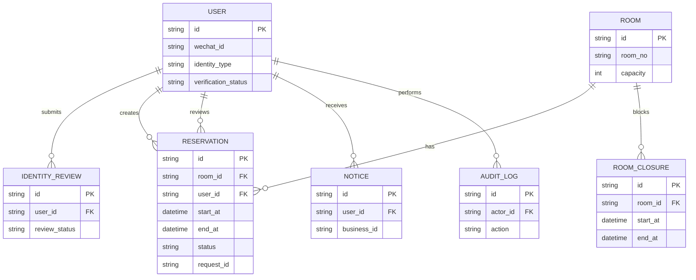

# 华中师范大学计算机学院会议室预定系统

# 需求调研与需求规格说明书（交接修订版 V1.1）

> **文档状态：课程项目需求基线候选稿，待业务负责人核对，不代表学院正式管理制度。**  
> 修订日期：2026 年 11 月 16 日｜产品形态：微信小程序｜计划周期：5 周｜团队规模：4 人  
> 适用范围：需求分析、UML 建模、原型设计、OpenSpec 规格驱动开发、前后端实现与验收。

## 修订记录

| 版本 | 日期 | 变更说明 | 状态 |
|---|---|---|---|
| V1.0 | 2026-11-13 | 初版业务规则、需求、用例和验收矩阵 | 项目内部交接稿 |
| V1.1 | 2026-11-16 | 区分调研证据与设计建议；收敛 P0/P1/P2；补充流程与 UML 图源、非功能验收方法、OpenSpec 协作与需求追溯；同步状态和测试要求 | **待小组及实际业务负责人评审** |

**说明：**本次修订以 V1.0 为依据，保留原稿明确记载的师生权限、房间信息、时间与预约业务规则；新增建议均单独标记为“设计约定/待确认”，不虚构访谈、问卷或实际系统性能。

---

## 1. 项目概述与文档边界

### 1.1 项目背景

根据项目成员提供的业务信息，计算机学院现有会议室借用通过人工联系办公室负责人、查阅和维护共享在线表格完成。教师可以直接借用并登记，学生需先由负责人确认。这些信息来自项目成员陈述，尚未由办公室实地核实；不据此断言已经出现高频冲突、严重延误或明确的效率损失。

项目拟开发面向**华中师范大学计算机学院师生**的微信小程序，为**南湖校区综合楼七楼的五间会议室**提供日程查询、预约申请、学生申请确认、个人预约管理与管理员台账等能力。

### 1.2 项目目标

1. 提供一个与共享表格相对应的统一会议室占用视图。
2. 支持**学生申请待确认、教师直接预约成功**两条不同业务路径。
3. 由服务端统一判断预约冲突、身份权限与状态转换。
4. 使师生能够查询本人预约和处理结果，负责人能够查看并处理待办。
5. 在 5 周课程周期内交付可演示、可测试、具有需求追溯记录的最小可用版本。

上述目标为项目设计目标，不预先宣称降低多少工作量、冲突率或等待时间；相关效果需测量后才能写入报告。

### 1.3 需求依据与证据等级

| 标记 | 含义 | 使用方法 |
|---|---|---|
| **C：项目成员确认** | 由项目成员明确说明或确认的业务信息 | 可用于课程设计；正式运营前仍须与学院负责人核对 |
| **D：设计约定** | 小组提出的具体实现规则、数据模型或交互方案 | 经评审后形成开发基线，不表述为学院现行规定 |
| **U：待核实** | 未获得业务证据、授权或资源信息 | 不填造数据；在原型中标注“待核实” |
| **V：已外部验证** | 有实际负责人访谈、表格证据、授权或测试记录支撑 | 当前版本**没有**此类已完成记录；后续附证据编号后才可使用 |

**重要界限：**“项目成员确认”与“学院正式确认”不同。统一身份认证接入资格、办公室的真实审批习惯、现有表格完整字段及数据保留期限均未核实。

### 1.4 项目范围与发布策略

- **P0：5 周内必须完成并验收的课程演示闭环。** 核验用户、查看五间房间、选择时段、教师直接预约、学生申请与负责人审核、本人取消、台账查询、冲突与权限校验。
- **P1：时间允许再做，或正式试运行前补齐。** 复杂停用与批量管理取消、独立通知中心、完整操作审计与自动后台状态整理、资源资料编辑等。
- **P2：不影响核心交付的增强。** 容量/设备组合筛选、统计图表等。

不包含付费、门禁、签到处罚、跨学院使用、自动排课、周期预约、自动同步旧在线表格及历史数据迁移。连续多日使用按**每天单独预约**处理，不提供批量或周期提交。

> **正式上线限制：**P0 是课程演示范围，不等于可直接投入学院真实业务。若学院要求线上管理停用、通知与留痕，须将相应 P1 提升至上线必备条件，并完成身份核验授权、隐私政策与数据留存审查。

---

## 2. 需求调研

### 2.1 已知调研事实与实际完成程度

本阶段采用项目成员业务信息收集、问题澄清、角色分析与场景推导，形成初步需求。**截至本版，不存在已经完成的办公室负责人访谈、教师/学生问卷或现有在线表格现场核验记录。** 以下拟访谈人数、问题清单与示例模板均属于后续计划，不计入已完成调研量。

### 2.2 现行业务流程（项目成员描述，待核实）

1. 学生联系办公室负责人说明借用需求。
2. 负责人查看与教师共同维护的在线表格，判断会议室时段是否空闲。
3. 如可借用，负责人办理并登记借用人、用途等信息。
4. 教师可以直接借用，但仍需要在在线文档中登记。
5. 多名办公室负责人可管理全部五间会议室。

现有流程的具体取消方式、历史冲突情况、谁可查看个人信息以及在线表格完整字段，**尚待实际确认**。

### 2.3 需求调研结果台账

| 编号 | 初步结论 | 证据等级 | 对应需求 | 待核实事项 |
|---|---|---|---|---|
| R01 | 服务对象限学院师生；管理范围是五间指定会议室 | C | F01、F02 | 学院使用授权 |
| R02 | 现有在线表格承担空闲查询与登记 | C | F03、F10 | 表头、更新责任、权限 |
| R03 | 学生申请需负责人确认；教师直接登记，新系统保留差异 | C | F04、F05 | 实际办理细则 |
| R04 | 多位负责人管理全部五间会议室 | C | F05、F10 | 负责人身份与数量 |
| R05 | 学生待确认申请也占用时段，拒绝/取消后释放 | C | F03、F04、F05 | 是否需要防占用滥用措施 |
| R06 | 开放 08:00—22:00，单次不跨日，无额外时长上限，可连续多日借用 | C | F03、F04 | 节假日或特殊房间限制 |
| R07 | 提前七天是建议，不是硬性预约窗口 | C | F04 | 是否有其他远期预约限制 |
| R08 | 开始前可取消；改期先取消再申请；停用时负责人可取消受影响预约，须写原因并通知 | C | F07、F08、F09 | 取消与通知的实际渠道 |
| R09 | 姓名、学工号、师生类型须核验；手机号、用途、预计人数必填 | C | F01、F04 | 核验材料和隐私告知 |
| R10 | 若获授权可接学校身份认证，否则人工审核 | C/U | F01 | 是否获批、认证字段 |
| R11 | 7060 容量待核实；7081、7091、7119、7052 分别为 12、12、80、35 人 | C/U | F02、F04 | 实际容量、设备与限制 |

### 2.4 初步问题分析：事实、推导与假设分开

| 编号 | 当前依据 | 需求推导或待验证假设 | 不得提前作出的结论 |
|---|---|---|---|
| A01 | R02：共享在线表格 | 提供统一日程查询与管理员台账（F03、F10） | 不得声称“现有表格经常出错” |
| A02 | R03：师生流程不同 | 设计教师/学生分支与管理员待办（F04、F05） | 不得把教师流程写成需要审批 |
| A03 | R04、R05：多人管理、待确认占用 | 用服务端原子校验避免双重占用（N02） | 不得声称已发生大量重复预约 |
| A04 | R09、R10：身份有核验要求 | 采用课程可实现的人工核验基线（F01） | 不得称微信登录等于学校身份认证 |
| A05 | 个人信息涉及手机号、学工号 | 限制普通用户查看，增加权限与隐私要求（N03、N04） | 不得声称已有学院数据处理授权 |

### 2.5 必做补充调研与证据归档

建议尽可能访谈**至少 1 名实际办公室负责人**，并在条件允许时访谈 3—5 名教师、5—8 名学生。上述为**建议样本量，不是已完成数量**。无法完成时应如实填写“未完成”，并在结题报告说明局限。

**负责人访谈问题：**

- 请按实际顺序演示最近一次学生和教师借用流程。
- 在线表格有哪些字段？谁能查看、填写、修改和取消？
- 学生待确认是否应立即占用？长时间未处理的申请怎么办？
- 如何核验学院资格、教师身份及学工号？谁被授权审核？
- 是否允许一个用户同时存在多个待确认申请？是否需要上限或提醒？
- 何时停用会议室，如何处理已经借出的预约，如何通知使用者？
- 五间房间的容量、设备、开放例外、历史记录的保存期限分别是什么？

**师生访谈问题：**最近一次借用的渠道、步骤、等待情况；希望如何看到空闲时段与状态；取消是否方便；最需要的预约信息；对个人信息可见范围的要求。

**调研记录模板（每条真实记录独立填写，不得编造）：**

| 证据编号 | 日期 | 对象/角色 | 方式 | 可核实的事实或摘录 | 对应需求 | 状态 |
|---|---|---|---|---|---|---|
| 待填 | 待填 | 待填 | 访谈/观察/脱敏资料 | 待填 | R__/F__ | 未完成 |

- 证据材料建议存放在 `docs/research/`，仅存脱敏记录和访谈纪要，不上传个人真实联系方式、学校凭证或未获许可的原表格。
- 如开展问卷，保留真实题目、原始有效样本数、剔除规则及统计方法，不能以建议样本量冒充回收数量。

### 2.6 待确认事项与处理责任

| 编号 | 待确认问题 | 阻塞情况 | 建议负责人 | 截止建议 |
|---|---|---|---|---|
| U01 | 办公室是否认可师生分流、待确认占用等核心规则 | 正式上线前必须确认；课程原型不阻塞 | C（需求）+ D（项目） | 第 1 周 |
| U02 | 人工审核可依据什么材料，学校认证是否可接入 | 正式真实身份核验前必须确认 | B（后端）+ C | 第 2 周 |
| U03 | 7060 容量、五间设备及特殊限制 | 可显示待核实，不阻塞原型 | C | 第 2 周 |
| U04 | 待确认申请是否需要数量限制/处理时限与负责人提醒 | 不得擅自加入业务硬限制 | C + D | 第 2 周 |
| U05 | 数据保存期限、管理员授权及隐私告知 | 正式运营前必须确认 | D（质量）+ C | 第 4 周 |
| U06 | 部署形式、云账号权限、资源额度及真机测试条件 | 开发联调的前置条件 | B + D | 第 1 周 |

---

## 3. 用户角色与权限

| 角色 | 查询日程 | 提交预约 | 处理学生申请 | 管理全部台账 | 身份审核与资源维护 |
|---|---|---|---|---|---|
| 未核验用户 | 否 | 否 | 否 | 否 | 仅能提交身份资料、看审核结果 |
| 已核验学生 | 是 | 提交后**待确认** | 否 | 否 | 否 |
| 已核验教师 | 是 | 提交后**直接成功** | 否 | 否 | 否 |
| 授权办公室负责人 | 按其已核验师生身份 | 按其本人师生身份 | 全部五间 | 全部五间 | 有权管理 |

- 办公室负责人权限必须经**独立后台授权配置**授予，不得凭客户端选择“教师/管理员”获得。
- 一名负责人自身预约时仍需已核验的师生身份；管理员角色**不自动等于教师**。
- 普通用户只能看到他人的**占用时段**，不能看到姓名、手机号、用途、审核记录、操作日志。
- 所有权限、记录归属与状态转换在服务端重新校验，前端隐藏按钮不能代替权限控制。

### 3.1 用例关系图（UML 源码）

下列 PlantUML 可导入 PlantUML、VS Code 扩展或其他支持的工具生成标准用例图；原稿并无经核实的额外角色。



> 图中按主职责表示用例关系；负责人若同时拥有已核验教师或学生身份，也可使用对应师生用例。

---

## 4. 资源信息与业务规则

### 4.1 五间会议室基础信息

| 房间号 | 地点 | 容量 | 设备 | 特殊限制 |
|---|---|---:|---|---|
| 7060 | 南湖校区综合楼七楼 | 待核实 | 待核实 | 待核实 |
| 7081 | 南湖校区综合楼七楼 | 12 | 待核实 | 待核实 |
| 7091 | 南湖校区综合楼七楼 | 12 | 待核实 | 待核实 |
| 7119 | 南湖校区综合楼七楼 | 80 | 待核实 | 待核实 |
| 7052 | 南湖校区综合楼七楼 | 35 | 待核实 | 待核实 |

原稿提供的容量暂作**项目成员数据**，正式使用前需与办公室核对。未知容量/设备在页面明确显示“待核实”，不能由开发人员自行补齐。

**容量校验设计约定：**已知容量时，预计人数大于容量则拒绝；7060 容量未知时仍需填写预计人数，但不因容量字段为空阻止提交，提示联系负责人确认。管理员修改容量不自动撤销历史预约，后续新提交和人工确认须使用当前容量再校验。

### 4.2 统一业务规则

| 编号 | 业务规则 | 依据 | P0 是否落实 |
|---|---|---|---|
| B01 | 仅已核验为学院师生者可查询/预约；教师身份必须核验 | C | 是 |
| B02 | 一次预约仅一间房、同一日期、一个起止区间；08:00 ≤ 开始 < 结束 ≤ 22:00 | C | 是 |
| B03 | “提前七天”为建议而非硬限制；预约开始时间必须晚于**服务端**当前时间 | C+D | 是 |
| B04 | 不附加单次时长上限；连续多天须逐日分别提交，结果独立 | C+D | 是 |
| B05 | 时间精确到分钟，无固定 30 分钟档；使用北京时间（Asia/Shanghai），相邻时段可衔接且无缓冲 | D | 是 |
| B06 | 学生提交成功变**待确认且占用**；教师提交成功变**预约成功且占用** | C | 是 |
| B07 | 待确认、预约成功及生效的停用时段阻止重叠预约；服务端必须保证最终写入一致性 | C+D | 预约冲突是；停用模块 P1 |
| B08 | 同房重叠判据：`新开始 < 已有结束 AND 新结束 > 已有开始`；不同房互不冲突 | D | 是 |
| B09 | 预约本人在**开始前**可取消待确认/预约成功记录，开始后不可自助取消 | C | 是 |
| B10 | 换房或改期均须先取消再重新申请；原预约不能恢复，新时段不保证可用 | C+D | 是 |
| B11 | 待确认到开始时仍未审批则**有效状态为已失效**，不再可确认；不得依赖延迟任务继续占用 | D | 是（逻辑状态） |
| B12 | 预约成功到结束时**有效状态为已完成**；完成不等于实际签到或使用 | D | 是（逻辑状态） |
| B13 | 管理员拒绝学生申请必须填写原因；停用取消须填写原因并产生可查通知 | C+D | 拒绝原因是；停用通知 P1 |
| B14 | 停用影响的待确认和成功预约需按重叠区间处理；历史已完成记录不变 | D | P1 |
| B15 | 停用前预览受影响记录，解除停用不自动恢复被取消预约 | D | P1 |
| B16 | 取消、拒绝、失效、完成为终态，保留历史，不直接编辑回有效状态 | D | 是 |

**并发细则：**教师与学生按服务端成功提交先后取得时段，不因教师身份覆盖已经待确认的学生申请。同一请求重试应返回同一结果，不得重复登记；多个负责人同时审批同一申请最多发生一次有效状态转换。

**规则保留与阶段划分：**原 V1.0 的停用规则 B13—B15 没有删除，但被列入 P1。仅完成 P0 的课程版本不应在说明书或演示中宣称已经支持正式的停用取消和通知机制。

### 4.3 待确认占用与防滥用：明确不擅自新增硬规则

R05 已明确：学生待确认申请占用时段，因此不能为“让别人也能预约”而悄悄改成不占用。**待确认没有提前自动过期时限**；按 B11，仅到预约开始时失效，这是当前设计约定。

这可能产生“单人提交大量待确认预约而长期占用”的风险，须向负责人询问是否允许增加以下措施：

| 方案 | 类型 | 处理意见 |
|---|---|---|
| A：每用户同时有效待确认申请数上限（具体数字待定） | **待确认业务变更** | **不得作为当前 P0 硬规则**，获同意后走 OpenSpec 变更流程 |
| B：负责人待办排序、超时提醒 | P1 交互增强 | 不改变现有占用规则，仍须核实提醒渠道 |
| C：同一按钮重复提交去重、请求幂等校验 | P0 技术防护 | 不改变预约权利，必须实现 |
| D：监测异常集中申请并供管理员查看 | P2 管理增强 | 不自动取消有效申请 |

任何限制预约数量、提前失效或教师优先占用的方案，都属于**业务规则变更**，不能用技术优化名义直接落地。

### 4.4 时段提交与状态一致性说明

- 查询日程只提供**当时的快照**；用户在页面看到空闲并不等于已锁定。
- 服务端提交时再检查身份、时间、容量、房间状态、冲突，并在保证并发互斥的机制内完成检查和写入。
- 根据部署技术选择可验证的原子方案：例如数据库事务与锁、原子占用索引或其他等效方案。**单纯“先查再写”不能证明无冲突。**
- 待确认到开始即不可审批；已完成记录保留历史，不能因定时任务没执行而继续被当作有效记录。
- 所有日期时间存储与比较应使用统一时区约定；后端决定当前时间、角色和最终状态。

---

## 5. 功能需求与优先级

### 5.1 优先级定义

- **P0｜课程必做：**最小可演示且可验收的完整业务链路，必须在第 3 周结束前基本联调通过。
- **P1｜增强/试运行前补齐：**不阻塞课程基础演示；若要求真正对学院开放，则根据管理部门要求转为上线必备。
- **P2｜选做：**有富余时间才做，不得挤占 P0 测试时间。

### 5.2 功能需求清单

| 编号 | 优先级 | 需求描述 | 验收要点 |
|---|---|---|---|
| **F01** | P0 | 微信会话与人工身份审核：提交姓名、学工号、师生类型、手机号；负责人核验并批准/拒绝 | 未审核不能预约；拒绝有原因可重提；学工号不能绑定不同有效账号；不能凭自选教师身份提权 |
| **F02** | P0 | 展示五间房间的编号、地点、容量、设备、当前可用信息 | 未知字段标为待核实，不伪造；错误或无数据有提示 |
| **F03** | P0 | 按房间、日期展示空闲/占用/非开放时间，以及已有有效停用信息（若 P1 已启用） | 他人待确认与成功均只显示“已占用”；不泄露个人信息；查询不锁定 |
| **F04** | P0 | 提交预约，校验必填项、资格、人数、时间、占用与重复请求；按师生类型分别生成状态 | 教师直接成功；学生待确认并占用；冲突和非法输入不创建有效记录；幂等有效 |
| **F05** | P0 | 任一授权负责人查看并确认/拒绝五间房间的学生待办 | 确认时复核资格、容量、停用及时间；拒绝必填原因；并发审批只能一次生效 |
| **F06** | P0 | 本人按日期/状态查看预约及详情、审批结果与原因 | 不能通过替换预约 ID 读取他人记录；历史记录可查 |
| **F07** | P0 | 开始前本人取消待确认或预约成功记录 | 二次确认；取消后释放；开始后拒绝自助取消；改期提示重新申请风险 |
| **F10** | P0 | 管理员按房间、日期、申请人和状态查询全部台账及必要联系方式 | 非负责人无法查询；历史状态与处理人可追溯到最小审计字段 |
| **F11** | P0 | 由服务端提供未处理到期失效、成功结束完成的**有效状态判定** | 即使无定时任务也不得允许逾期审批/错误占用；查询展示正确状态 |
| **F08** | P1 | 房间资料维护、创建/解除停用；预览并一致地取消受影响预约，记录原因 | 无部分成功且不提示；已完成记录不变；解除不恢复被取消记录 |
| **F09** | P1 | 独立站内通知中心：身份审批、确认、拒绝、失效、停用取消及已读状态 | 不授权微信订阅消息也能在站内查看结果；订阅消息选做且不保证必达 |
| **F11E** | P1 | 自动任务持久化整理已失效/已完成状态，并保留完整操作日志 | 与 F11 逻辑状态保持一致；任务延迟不影响业务正确性 |
| **F12** | P2 | 按已知容量、设备组合筛选房间 | 7060 未知容量不被误认为满足容量条件 |
| **F13** | P2 | 预约数量、时长统计与可视化 | 明确时间范围和统计状态；不能把预约时长等同实际使用时长 |

> **P0 功能数量：9 项（F01—F07、F10、F11）。** P1 项目保留原稿编号，并将后台持久化状态整理细化为 F11E。F08、F09 不在 P0 交付承诺内，但其业务规则与未来验收条件继续保留。

### 5.3 P0 完成判定

满足以下条件才算完成核心版本：①学生、教师、负责人三条主要路径均走通；②同房重叠不允许产生两条有效预约；③他人信息不会因接口越权泄露；④取消、拒绝、失效行为符合状态规则；⑤运行和演示环境可以重现核心流程；⑥每个 P0 在测试表中有成功、失败或边界验收记录。

### 5.4 身份认证方案与限制

课程可实施基线为 F01 的人工审核。若学院授权接入校级统一身份认证，需另行确认授权、接口、返回字段及归属验证方式，完成变更评审后再替换登录流程；不能把“校方有相关平台”当作本课程已经获准接入的证据。**系统不采集校园统一认证密码，也不仿制学校登录页。**

人工审核必须有可落实的核验渠道；若无法取得实际授权与材料，课程演示仅使用**虚构/经同意的测试身份**，不得声称已真实核验学院师生。

学校公开服务参考：<https://nisc.ccnu.edu.cn/ITfw/yyyjc.htm>（仅供后续确认，不构成授权）。

---

## 6. 主要业务用例与活动流程

### UC01：身份审核（F01）

- **参与者：**未核验用户、授权负责人。
- **前置条件：**已建立微信会话。
- **主流程：**填写姓名、学工号、师生类型、手机号 → 基本格式校验 → 提交待审核 → 负责人根据可核实依据检查学院归属与师生类型 → 批准 → 用户获得对应师生业务权限。
- **异常/替代流程：**字段无效则提示；无法核验则拒绝并说明原因；被拒允许重提；学工号冲突仅提示联系负责人，不暴露另一账号信息。
- **后置条件：**保存审核历史，用户可查看审核状态和原因。
- **外部依赖：**实际核验材料/授权未落实，课程演示只用测试数据。

### UC02：查询会议室空闲（F02、F03）

- **参与者：**已核验师生。
- **主流程：**进入会议室列表 → 选择房间与日期 → 查看房间资料、空闲和占用时段 → 选择空闲时段进入申请表单。
- **异常：**网络失败、资料未知、房间不存在、已占用或非开放时段均有明确提示。
- **后置：**查询不锁定时段，正式提交再次校验。

### UC03：学生预约申请（F04）

- **前置：**已核验学院学生、目标日期和时段合法。
- **主流程：**选择房间与时段 → 填写用途、预计人数、手机号、可选备注 → 提交 → 服务端检查 → 创建**待确认**预约并占用 → 显示预约编号与“尚需负责人确认”。
- **异常：**冲突、停用、超容量、身份失效或非法时间不创建有效预约；网络重试应通过请求标识去重或查询最终结果。
- **后置：**负责人待办可见；其他人只见占用。

### UC04：教师直接预约（F04）

- **前置：**教师身份经过核验。
- **主流程：**填写与 UC03 相同业务字段 → 服务端校验 → 直接生成**预约成功**并占用 → 显示编号与结果。
- **异常：**与学生待确认也算冲突；客户端不能伪造教师身份。

### UC05：负责人审批学生申请（F05）

- **前置：**已授权负责人；申请仍为待确认且尚未到开始时间。
- **批准路径：**查看申请 → 重新检验当前资格、时间、容量及停用情况（排除本申请自身的占用）→ 原子改为预约成功 → 记录处理人和时间。
- **拒绝路径：**填写拒绝原因 → 改为已拒绝并释放占用 → 记录处理人和时间。
- **并发异常：**其他负责人已处理、申请人已取消或申请已经失效时，显示最新状态而非重复处理。

### UC06：取消与重新申请（F07）

- **前置：**本人、记录仍为待确认或预约成功、开始时间尚未到达。
- **主流程：**进入预约详情 → 点击取消 → 二次确认 → 原预约改为已取消、释放占用 → 按需重新申请新时段。
- **异常：**开始后不允许自助取消；状态变化导致取消失败时展示最新状态。
- **后置：**旧记录保留且不能恢复，新时段不保证成功。

### UC08：查询本人预约及处理结果（F06）

- **参与者：**已核验学生或教师。
- **前置：**用户已登录并通过身份核验。
- **主流程：**进入“我的预约” → 按日期或状态查看本人记录 → 打开详情 → 查看房间、起止时段、当前有效状态、申请/处理时间及拒绝或取消原因。
- **异常：**列表无数据提示空状态；服务端禁止通过修改记录 ID 访问他人预约；网络故障提示重试，不显示未授权信息。
- **后置：**只读取记录，不修改占用。可从有效预约详情进入 UC06 取消流程。

### UC07：停用与受影响预约处理（F08，P1）

- **参与者：**授权负责人。
- **主流程：**选择会议室与停用区间 → 填写原因 → 预览受影响的待确认/成功预约 → 确认 → 在一致性保障下创建停用、处理受影响预约、记录操作者 → 产生可查看的通知记录（F09）。
- **异常：**预览之后数据变化须再次确认；事务不能部分成功而无告警。解除停用只释放停用区间，不恢复已取消记录。
- **说明：**在仅完成 P0 时此用例保留在规格中但标记“未实现”，不得演示为已上线。

### 6.1 师生预约与审核活动图（Mermaid）



**注意：**图示为主要分支，学生与教师提交均须遵循同一服务端冲突控制；“校验通过”与“写入成功”必须在并发机制下保持一致。

---

## 7. 状态模型

### 7.1 身份状态

`未提交 → 待审核 → 已通过 / 已拒绝`；已拒绝可重新提交为待审核。已通过后的身份关键字段由负责人重新审核才允许修改。已撤销资格者不能发起新的业务；若存在尚未结束的有效预约，须由负责人处理并留原因，属于需补齐的管理能力，课程 P0 不声称自动完成。

### 7.2 预约状态转换表

| 起点 | 触发事件 | 终点 | 占用变化 | 实施说明 |
|---|---|---|---|---|
| 无 | 学生提交成功 | 待确认 | 开始占用 | P0 |
| 无 | 教师提交成功 | 预约成功 | 开始占用 | P0 |
| 待确认 | 负责人批准 | 预约成功 | 继续占用 | P0 |
| 待确认 | 负责人拒绝 | 已拒绝 | 释放 | P0 |
| 待确认/预约成功 | 本人开始前取消 | 已取消 | 释放 | P0 |
| 待确认 | 到开始时间未审批 | 已失效 | 释放 | P0 有效状态；持久化整理 P1 |
| 预约成功 | 到结束时间 | 已完成 | 不再占用未来时段 | P0 有效状态；持久化整理 P1 |
| 待确认/预约成功 | 管理员因停用等管理取消 | 已取消 | 释放，记录原因 | P1 |

终态不恢复。确认/拒绝/取消/失效并发时，只允许符合当前有效状态和服务端时间的一次合法转换。

### 7.3 预约状态图（Mermaid）



说明：`已失效`/`已完成`可先由服务端根据当前时间得出“有效状态”，无需等待后台批处理完成数据库字段更新。查询、提交、审批、冲突校验须使用一致判定逻辑。

---

## 8. 数据字典与概念数据模型

### 8.1 数据实体与字段

| 实体 | 关键字段 | 约束与说明 |
|---|---|---|
| 用户 | 用户 ID、微信关联标识、姓名、学工号、师生类型、手机号、身份状态 | 姓名 1—50 字；学工号 1—30 字符，正式格式待核实；有效绑定唯一；负责人授权独立存储 |
| 身份审核记录 | 审核 ID、用户、提交资料快照、状态、处理人、原因、提交/处理时间 | 被拒绝可重提，留历史；敏感信息仅授权人员可见 |
| 会议室 | ID、房间号、地点、容量、设备、资料状态 | 五间固定种子数据；容量为正整数或空；房间号唯一 |
| 预约 | ID、房间、申请人、姓名/联系方式快照、日期、起止时间、用途、人数、手机号、备注、状态、提交时间、审核/取消信息、请求标识 | 用途 1—200 字，人数正整数，备注 ≤500 字；服务端确定权威字段；请求标识用于幂等 |
| 停用安排（P1） | ID、房间、起止时间、原因、创建人、状态 | 可跨日，对预约逐日求重叠；解除后不可自动恢复已取消预约 |
| 站内通知（P1） | ID、接收人、业务类型、关联记录、内容、生成/已读时间 | 仅接收人可读；不依赖微信订阅授权 |
| 操作日志 | ID、操作者、对象 ID、动作、时间、结果及必要变更摘要 | P0 保存最低限度审批/取消处理人和时间；P1 完整审计；不记录密码或会话凭证 |

手机号仅作中国大陆 11 位基本格式检查，不把通过格式校验当作已验证手机号真实性。用户首次填报信息可以预填后续预约表单，但提交预约时手机号仍须确认。前端不能指定审批人、身份权限、最终状态或服务器时间。

### 8.2 概念实体关系（Mermaid）



该图用于理解概念关系，不等于最终物理数据库结构。若采用 CloudBase 文档数据库，关系以关联 ID/集合表示；若采用 MySQL，则按外键、索引及事务约束设计。无论使用何种技术，都必须对业务并发正确性进行实测。

---

## 9. 小程序原型与页面需求

| 页面 | 优先级 | 必要内容 | 特别状态/约束 |
|---|---|---|---|
| 登录与身份提交 | P0 | 姓名、学工号、师生类型、手机号、提交按钮 | 未提交/提交中/校验失败/网络失败 |
| 身份审核结果 | P0 | 待审核、已通过、拒绝原因、重新提交 | 不把用户自选教师类型当作已核验 |
| 房间列表 | P0 | 五间房号、容量、位置、进入详情 | 未知容量“待核实”、加载失败 |
| 房间详情与日程 | P0 | 日期切换、08:00—22:00 时段、设备、占用提示 | 他人占用不显示个人资料；选择时段不锁定 |
| 预约表单 | P0 | 日期、时段、用途、人数、手机号、选填备注 | 学生“待确认”提示、教师“直接成功”提示、冲突与超容量 |
| 提交结果 | P0 | 编号、会议室、日期、状态、详情入口 | 网络断开时引导查询结果，避免重复提交 |
| 我的预约与详情 | P0 | 日期/状态、本人信息、取消入口、处理原因 | 开始后不可自助取消；终态不能恢复 |
| 管理待办 | P0 | 身份审核及学生预约待办分类 | 多负责人重复处理时刷新结果 |
| 管理申请详情 | P0 | 申请人、手机号、用途、时段、人数、批准/拒绝 | 拒绝理由必填；批准前重新校验 |
| 管理台账 | P0 | 房间、日期、状态、申请人筛选与详情 | 仅授权负责人可见 |
| 房间资料维护与停用 | P1 | 编辑资料、创建停用、影响预览、取消与解除 | 变更前二次确认，需审计 |
| 站内通知中心 | P1 | 身份结果、预约处理结果及已读状态 | 无订阅消息权限也可查看站内结果 |
| 筛选与预约统计 | P2 | 容量/设备组合筛选、统计看板 | 未知数据不虚构、指标口径明确 |

原型最低验收：覆盖**学生、教师、负责人**三种主路径及“无数据/加载失败/超容量/冲突/已被他人处理/取消不可用”等异常提示。管理员入口是否显示由登录身份辅助决定，但最终权限必须由服务端判定。

---

## 10. 非功能需求与可执行验收

以下数值为课程项目**建议验收目标**，不是已测量结果，不应写成现有系统能力；实际测试需记录设备、网络、数据库、云资源配置及样本数。如云环境资源或免费额度不支持，应报告偏差，不伪造通过。

| 编号 | 类别 | 要求与目标 | 验收方法 | 优先级 |
|---|---|---|---|---|
| **N01** | 性能 | 基线场景：5 间房、约 100 个测试账号、至少 500 条合成历史预约；在 **5 并发用户**的核心查询/提交场景下，稳态请求 P95 目标 ≤3 秒，非预期错误率 <1%；云函数冷启动单独记录 | 记录请求量、环境、P50/P95、失败类型；合法业务冲突不算非预期错误 | P0 |
| **N02** | 一致性 | 同房重叠时段至多一条有效预约；同一请求重试不重复；同一待办至多一次成功处理 | 至少覆盖同房抢约、学生/教师竞争、负责人重复审批、审批与取消竞争；每类执行 20 次并记录结果 | P0 |
| **N03** | 权限 | 登录、学院资格、师生角色、管理员授权及记录归属在服务端验证 | 以未登录、未核验、学生、教师、负责人身份访问接口并替换他人记录 ID | P0 |
| **N04** | 隐私与安全 | 不收学校密码；他人日程不含借用人、学工号、电话、用途；不在公开仓库提交密钥或真实个人数据；正式独立后端用 HTTPS | 检查页面、接口响应、日志、Git 仓库和部署配置；人工身份资料仅授权人员可读 | P0 |
| **N05** | 数据持久性 | 预约成功后，在应用/开发工具重启后仍可查询一致记录；正式运营备份方案和恢复目标待定 | 以测试账号创建预约→重启→检查内容；备份和恢复演练为 P1，未做不得声称达标 | P0/P1 |
| **N06** | 易用性 | 目标：至少 5 名首次使用的代表性测试者中 4 名，可在无口头指导下 3 分钟内完成指定合法时段的查询与提交 | 统一任务、记录耗时/失败原因；人员不足则如实报告样本不足 | P0 |
| **N07** | 兼容性 | 核心流程在微信开发者工具及**至少 1 台 Android 和 1 台 iOS 真机**通过；若设备缺失必须注明未覆盖 | 保存机型、系统版本、微信版本与截图，不以模拟器替代真机结果 | P0 |
| **N08** | 时间边界 | 统一北京时间，服务端判断；开始时间必须晚于服务端当前时间，分钟精度；相邻可用、跨日拒绝 | 验证 08:00/22:00、相邻、过去、开始瞬间及客户端时间被改动场景 | P0 |
| **N09** | 可追溯性 | 每条 P0 功能至少关联一条验收测试；审批与取消保留处理人、时间和状态 | 核对 F—T 追溯矩阵与相关数据记录 | P0 |
| **N10** | 可维护与输入安全 | 校验规则前后端一致；用户输入不可导致脚本执行或异常写入；敏感配置与代码分离 | 空白/超长/特殊字符测试；检查错误提示和配置管理 | P0 |

**说明：**N01 从 V1.0 的“20 并发、1 万条记录、P95 ≤2 秒”调整为更适合 5 周项目的基线目标；原指标可作为**P2 扩展压测**，不应在未执行时写为通过。N05 原“每日备份、RPO ≤24 小时、RTO ≤2 小时”保留为未来正式部署时的待评审建议，不作为当前演示完成条件。

**隐私/运维上线门槛：**真实个人信息采集的依据、告知方式、访问范围、保存与删除期限、备份策略，以及云平台或独立服务器的账号权限、HTTPS 与成本预算，均须正式确认。课程测试优先使用虚构或获得明确同意的数据；不得上传真实校园凭证。

### 10.1 建议开发与测试环境

| 环境 | 用途 | 推荐配置 | 责任人 |
|---|---|---|---|
| 本地前端开发 | 页面编写与调试 | 微信开发者工具、Node.js（按项目需要）、Git | A |
| 本地后端/云函数 | API 与业务逻辑 | Node.js；云开发云函数或 Express 服务二选一 | B |
| 共享测试数据环境 | 联调与验收 | 一套隔离的测试数据库、5 间会议室种子数据、虚构账号 | B + D |
| 规范与代码仓库 | 多人协作 | GitHub/Gitee + `openspec/` + 测试文件夹；采用分支合并 | C 维护规范；全员提交 |
| 演示环境 | 第 4/5 周回归、答辩 | 优先 CloudBase；如老师硬性要求独立部署再用合规云服务器 | B + D |

**部署选择：**微信云开发（CloudBase）的云函数与数据库能减少服务器维护；如使用独立 Express/MySQL 服务，另需核查 HTTPS、合法请求域名等微信小程序访问条件。费用、免费额度和可用服务以开通时的官方实际条款为准，不在需求文档写死价格。开发阶段无需购买实体服务器。

---

## 11. 验收场景与需求追溯

### 11.1 核心验收矩阵（P0）

| 测试编号 | 对应需求/规则 | 操作场景 | 预期结果 |
|---|---|---|---|
| T01 | R01/F01/N03 | 未核验用户访问业务日程、预约接口，尝试伪造教师/管理员角色 | 被拒绝，无权限提升 |
| T02 | R09/F01 | 提交身份、负责人拒绝/批准、重复学工号绑定 | 状态正确；拒绝可重提；冲突不泄露他人数据 |
| T03 | R11/F02 | 查看五间会议室资料 | 房号和已知容量正确；7060 容量及未知设备显示待核实 |
| T04 | R05/F03/F04/N02 | 学生提交待确认，同房同段另一账号再提交 | 第一条占用，第二条冲突失败 |
| T05 | R03/F04 | 教师和学生分别提交合法请求 | 教师直接预约成功；学生待确认；用途/人数/手机号校验有效 |
| T06 | R04/F05 | 不同负责人处理同一份待办 | 只有一次有效状态变化，处理人可追溯 |
| T07 | B07/F04/N02 | 并发争抢同房时段；相同请求标识重发 | 至多一份有效预约；重复请求不生成第二份 |
| T08 | B02/B05/N08 | 08:00/22:00、相邻时段、跨日、开始已过去 | 合法边界通过，非法边界拒绝；无附加 4 小时时长限制 |
| T09 | R07/F04 | 对超过 7 天的合法未来日期预约、连续多日逐日提交 | 不因超过 7 天自动拒绝；按日独立创建 |
| T10 | R11/F04 | 12 人房间填写 13 人；7060 填写人数 | 前者拒绝；后者提示容量待核实但不因未知容量拒绝 |
| T11 | R08/F07 | 开始前取消、开始后取消、改期 | 取消只在开始前成功；旧记录保留，改期需新申请 |
| T12 | B11/F11/N08 | 到开始时间仍未处理的学生预约，再尝试审批 | 有效状态已失效，负责人不能再批准；不依赖定时任务 |
| T13 | B12/F11 | 预约成功跨过结束时间再查询 | 有效状态已完成，历史仍保留 |
| T14 | F03/F06/N04 | 访问别人日程与通过修改记录 ID 读取详情 | 不泄露他人身份和预约详情 |
| T15 | F05/F07/F11 | 审批与本人取消、审批与自动失效同时竞争 | 只发生合法状态转换，信息一致 |
| T16 | F04/N01/N05 | 网络中断重试提交、重启再查、基线性能测试 | 无重复记录；重启不丢失；性能结论按实测填写 |
| T17 | F10/N03/N09 | 普通用户和负责人分别访问管理台账 | 普通用户拒绝，负责人按权限查看并有处理记录 |
| T18 | N06/N07/N10 | 首次用户任务、真机检查、非法输入 | 如实记录完成率、机型、问题与修复，不以“计划测试”代替通过 |

### 11.2 扩展验收矩阵（P1/P2）

| 测试编号 | 功能 | 场景 | 预期结果 |
|---|---|---|---|
| XT01 | F08/P1 | 停用前后受影响预约变化，确认与撤销 | 无不明部分成功；原因和变更记录保留；解除不恢复预约 |
| XT02 | F09/P1 | 用户拒绝微信订阅消息权限，查看站内处理结果 | 站内可查，不依赖订阅消息 |
| XT03 | F11E/P1 | 后台定时整理延迟或重复执行 | 结果幂等且不影响 P0 的逻辑状态正确性 |
| XT04 | F12/P2 | 按容量/设备筛选 | 未知容量不被误判满足条件 |
| XT05 | F13/P2 | 统计数量和预约时长 | 指标时间区间、状态口径正确，不冒称实际使用率 |

### 11.3 需求—用例—页面—测试追溯矩阵

| 功能需求 | 用例 | 关键页面 | 验收测试 |
|---|---|---|---|
| F01 | UC01 | 登录与身份提交、审核结果、管理待办 | T01、T02 |
| F02 | UC02 | 房间列表/详情 | T03 |
| F03 | UC02 | 房间日程 | T04、T14 |
| F04 | UC03、UC04 | 预约表单、提交结果 | T04、T05、T07—T10、T16 |
| F05 | UC05 | 管理待办与审批详情 | T06、T15 |
| F06 | UC08 | 我的预约与详情 | T11、T14 |
| F07 | UC06 | 预约详情 | T11、T15 |
| F10 | 管理台账场景 | 管理台账 | T17 |
| F11 | UC05、状态模型 | 我的预约、管理待办 | T12、T13、T15 |
| F08/P1 | UC07 | 资源与停用管理 | XT01 |
| F09/P1 | UC01、UC05、UC07结果查看 | 通知中心 | XT02 |
| F11E/P1 | 状态模型 | 管理维护 | XT03 |
| F12/P2、F13/P2 | 扩展场景 | 筛选与统计 | XT04、XT05 |

> V1.1 已为 F06 补充独立的 UC08，明确“查看本人预约”和 UC06“取消本人预约”是不同用例；P0 验收应覆盖两者。

### 11.4 验收记录模板

每次测试至少记录：**测试编号、执行日期、代码版本/提交哈希、部署环境、测试账号角色、前置数据、操作步骤、预期、实际、截图或日志证据、通过/失败、缺陷编号、复测结果**。

| 测试编号 | 日期 | 环境/版本 | 实际结果与证据 | 状态 | 缺陷/复测 |
|---|---|---|---|---|---|
| T__ | 待执行 | 待记录 | 待记录 | 未执行 | 待填 |

未运行的测试必须保留“未执行”，不得提前填写通过。

---

## 12. OpenSpec 与四人团队协作方案

### 12.1 采用方式

使用 **OpenSpec** 管理核心功能的**规格—设计—任务—实现—验证—归档**过程；OpenSpec 是开发过程工具，不替代本需求调研文档，也不替代真实调研和测试。具体初始化命令、文件路径和验证命令按项目实际安装版本的官方说明执行；以下为建议仓库结构而非强制工具生成结构。

```text
meeting-room-system/
├── miniprogram/                 # A：微信小程序前端
├── cloudfunctions/              # B：云函数，或替换为 backend/
├── openspec/                    # C 主维护：功能规范、变更提案、设计和任务
├── tests/                       # D 主维护：接口/并发/权限/验收测试
├── docs/
│   ├── research/                # 脱敏调研材料与待核实事项
│   ├── design/                  # UML、ER、页面原型与接口说明
│   └── delivery/                # 部署、演示与交付文档
└── README.md
```

### 12.2 OpenSpec 工作流与示例

1. **提出变更（propose）：**围绕一个可独立验收的功能提出目的、范围、影响和仍待确认的业务规则。
2. **编写规格与设计：**描述前置条件、主流程、异常、权限、边界和验收场景；说明接口、数据模型、并发机制。
3. **分解任务（tasks）：**拆分前端、后端、测试与规范责任，记录完成条件。
4. **实施（apply）：**A/B 根据规格开发；D 同步增加测试；C 校对需求一致性。
5. **验证与归档（verify/archive）：**按测试矩阵保留真实证据；需求发生变化时先更新规格，再修改代码和测试。

建议最少形成四个独立功能单元：`identity-verification`、`room-schedule`、`reservation-lifecycle`、`admin-review`。**“待确认申请数量上限”在 U04 业务审核完成前不得写成已批准的规格要求。**

**规格片段示例（仅示例，不冒充工具自动生成内容）：**

```markdown
### Requirement: 待确认申请占用时段（B06）
- WHEN 已核验学生提交合法预约且最终写入成功
- THEN 系统创建状态为“待确认”的预约，并将该时段标为“已占用”
- WHEN 另一用户提交同一会议室重叠时段的预约
- THEN 服务端拒绝第二份有效预约，返回冲突提示
- WHEN 原待确认申请被拒绝或开始前取消
- THEN 该记录不再占用时段，历史记录保留
```

### 12.3 职责分工与协作界面

| 成员 | 岗位 | 主要产物 | 必须参与的评审 |
|---|---|---|---|
| **A** | 前端开发负责人 | 小程序页面、原型对照、前端校验与交互测试 | 页面原型、接口、端到端联调 |
| **B** | 后端开发负责人 | 业务 API/云函数、数据模型、预约原子校验、权限 | 规则、接口、安全、并发测试 |
| **C** | 需求分析与系统设计负责人 | 调研纪要、需求基线、UML/原型、OpenSpec 规格 | 需求变更、功能验收、需求追溯 |
| **D** | 项目管理与质量保障负责人 | 协助调研、五周任务管理、测试计划/脚本、部署与报告 | 需求评审、缺陷处理、上线/答辩验收 |

**C 与 D 共同承担需求调研：**C 侧重访谈整理、业务规则和设计建模，D 侧重非功能目标、需求验收、进度风险与测试。避免把“需求分析＋OpenSpec＋项目管理＋全部测试”压给同一人。

### 12.4 五周里程碑

| 周次 | 重点任务 | 本周结束时的可验收产物 |
|---|---|---|
| **第 1 周** | C/D 明确需求及未核实事项、出原型/UML；A/B 建仓库、选技术、完成前后端最小连通；初始化 OpenSpec | 需求基线候选稿、原型草图、功能列表、API 草案、可读取测试房间的最小项目 |
| **第 2 周** | A 实现登录/房间列表/日程；B 完成身份、房间、预约基础接口；C 更新规格；D 完成接口与边界测试设计 | 身份与查询可演示，预约基本请求跑通，有测试数据和初测证据 |
| **第 3 周** | A/B 完成师生预约、审批、取消、台账及联调；C/D 验收核心路径和异常 | **P0 核心闭环基本完成**；冲突、越权、重复审批最关键测试通过 |
| **第 4 周** | 优先修复缺陷，开展性能/真机/恢复测试；如有余力实现 P1；C 维护追溯 | 功能冻结候选版、测试报告、已知缺陷清单、部署说明 |
| **第 5 周** | 回归测试、真实演示流程、交付文档与答辩；规范归档 | 可复现演示、完整代码、OpenSpec 记录、需求与设计文档、最终测试报告和 PPT |

每周建议召开 1 次短会，检查**已完成、阻塞、风险、下一周任务**；功能变更先同步 C/D，再由 A/B 评估技术影响。新增 P1 功能不得挤占 P0 验收及问题修复时间。

---

## 13. 风险、依赖与发布约束

| 风险 | 影响 | 处理策略 |
|---|---|---|
| 真实负责人访谈与资料无法取得 | 规则与身份流程可能与实际不符 | 继续课程演示，但将未核实信息标记 U；正式使用前不得宣称学院已认可 |
| 学校统一身份认证未获授权 | 无法自动验证真实师生身份 | 采用人工审核或测试身份；不采集学校密码、不模拟登录页 |
| 并发预约发生重复占用 | 核心业务错误 | 后端确定互斥机制，D 做竞争测试；不以“先查再写”作为完成标准 |
| 云开发/服务器环境受限 | 联调或上线受阻 | 第 1 周确定环境；不把正式发布当成课程演示唯一方式 |
| P1 侵占开发时间 | P0 无法按期交付 | 第 3 周前只做 P0；第 4 周优先缺陷修复与验收 |
| 真实个人资料泄露 | 隐私与合规风险 | 用虚构测试数据，服务端权限校验，禁止密钥提交仓库 |
| 管理停用/结果通知未做 | P0 不具备完整正式运营能力 | 明确演示范围；真正在学院使用前补齐 P1 并通过业务评审 |

### 正式试运行前必须完成的外部前置事项

1. 经实际管理部门核对关键预约业务规则和五间房间数据。
2. 明确谁有权审核师生身份、授予管理员权限，并落实真实可用核验依据。
3. 明确个人信息处理告知、授权、访问控制、保存期限及清理方法。
4. 完成部署环境、域名/HTTPS（如适用）、账号与资源安全评审。
5. 补齐管理停用、受影响预约处理和必要的结果通知机制（原稿 F08/F09）。
6. 在目标环境完成最少一次并发冲突、权限、备份或恢复策略及真机验收。

---

## 14. 交接清单与验收结论模板

### 给需求与建模同学（C）

- 根据第 3 节 PlantUML 生成正式用例图；根据 6.1 节生成活动图；根据 7.3 节生成状态图；基于第 8 节形成概念 ER 图。
- 组织项目组复核 R01—R11、B01—B16、U01—U06。保留设计约定与学院规则的区别。
- 将最终确认的 P0 拆成 OpenSpec 功能规格与任务清单；任何业务变更更新需求编号及追溯矩阵。

### 给前端同学（A）

- 优先按第 9 节实现 P0 页面及三类用户的主路径；页面只显示权限允许的内容。
- 设计学生待确认、教师已成功、冲突、失效、取消不可用、重复提交结果不确定等反馈。
- 不依赖前端隐藏按钮保证权限，不把页面可选空闲当成最终预约成功。

### 给后端同学（B）

- 优先完成身份、房间、预约、审批、取消、台账模块及服务端时间/权限校验。
- 写明预约并发互斥方案、重复请求识别方案、状态转换条件与接口错误码。
- 根据部署方式确定云函数/数据库事务或其他等效机制，并配合 T07、T15 验证。

### 给项目管理与测试同学（D）

- 将第 11 节测试场景拆成可执行步骤；记录实际执行版本、真实结果与证据。
- 从第 1 周跟踪 U01—U06；与 C 一同承担调研核实和非功能要求评审。
- 第 4 周完成关键回归、越权和并发测试，整理未解决问题；第 5 周负责复现与交付环境核验。

### 项目验收结论（由测试完成后填写，当前不得预填）

| 项目 | 结果 | 依据 |
|---|---|---|
| P0 功能通过情况 | 未测试 | 待关联 T01—T18 |
| 并发一致性 | 未测试 | 待记录测试结果 |
| 权限与隐私 | 未测试 | 待记录接口与页面结果 |
| 易用性与真机兼容 | 未测试 | 待记录设备与人员样本 |
| OpenSpec 规范归档 | 未完成 | 待提供仓库目录、变更记录 |
| 实际业务负责人核对 | 未完成 | 待附脱敏访谈/确认记录 |
| 课程演示是否可交付 | 待定 | 全组共同确认 |
| 是否符合真实上线条件 | **当前不作符合声明** | 见第 13 节上线前置条件 |

---

## 附录 A：与 V1.0 相比的关键调整

1. **需求调研：**保留 R01—R11，新增证据等级、实际调研状态、调研模板、待核实事项和需求推导表，避免把计划当成已完成。
2. **功能范围：**将 F01—F07、F10、F11 定为 P0；F08/F09 及后台状态整理定为 P1；F12/F13 定为 P2。原业务规则不删除，明确未实现范围。
3. **预约占用：**保留“学生待确认即占用”，将数量上限或提前超时等作为**待业务批准的建议**，不擅自引入。
4. **状态与并发：**明确逻辑状态与后台持久化任务分离，要求服务端原子性、幂等性和一致性，避免云函数冷启动或定时任务延迟影响业务正确性。
5. **非功能要求：**调整课程基线压测规模，将备份恢复目标列为上线前另行确认；保留可验证的安全、易用和兼容要求。
6. **图表与过程：**新增 PlantUML 用例图、Mermaid 活动图/状态图/ER 图、OpenSpec 工作流、四人职责、五周里程碑与可执行验收矩阵。
7. **交付声明：**明确课程 P0 不等于正式学院上线，未完成真实访谈、授权和测试的项目必须如实标注。

## 附录 B：待确认事项的填写规则

待补资料统一使用“待核实 / 未完成 / 未测试 / 待定”，不得用合理猜测填充事实字段。每次获得外部证据时，为证据分配编号，在 `docs/research/` 保留脱敏材料，修改 R/U 条目、相关 F/B 规则、OpenSpec 功能规格及对应测试，并在修订记录说明原因。
